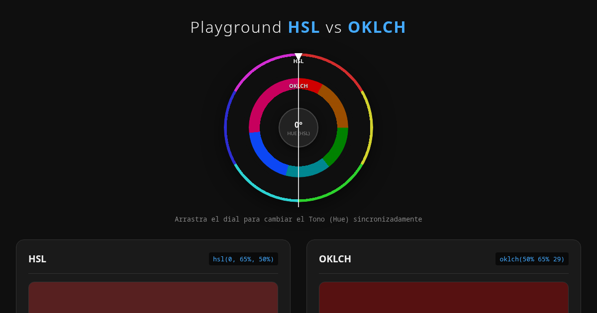

# 🎨 Color Compass — OKLCH vs HSL Playground

An interactive, visual, educational tool for understanding the difference between the
traditional HSL colour model and the modern, perceptually uniform OKLCH colour space.

If you've ever wondered why a 50% lightness in HSL looks completely different depending
on the hue, or why the oklch() hue angles seem "rotated" compared to HSL, this is for
you.



**Live:** https://senseikatana.com/hueplay/
**Field guide:** https://senseikatana.com/hueplay/historia/

---

## What it does

- **A 360° dual-ring dial.** The outer ring is HSL's exact 60° sectors. The inner ring
  paints the same six HSL primaries at their _true_ OKLCH hues, so its sectors are
  visibly uneven. That deformation is the whole point of the second ring.
- **A real bidirectional hue mapping.** Dragging one model moves the other. This is not a
  lookup table — the library converts the actual colour (sRGB → linearize → OKLab →
  polar), which is why the mapping depends on saturation and lightness, not just the
  angle.
- **Paste a colour, get every equivalent.** One field accepts `#f00`, `#rrggbb`,
  `#rrggbbaa`, `rgb()`, `hsl()` and `oklch()`, in modern _and_ legacy comma syntax,
  including CSS angle units. Press **Aplicar** and all six sliders are seeded with the
  exact conversion, every control still editable.
- **Exact output chips** for `#hex`, `hsl()` and `oklch()`, click to copy.
- **A gamut badge** that lights up when the browser will not paint exactly what you
  asked for. It is measured perceptually (ΔE in OKLab), not by containment.
- **A keyboard-operable dial.** Arrows, `Shift`+arrows, `Home` and `End`.
- **Shareable state** — the full six-slider state lives in the query string.
- **La mentira de la luminosidad** — an interactive demo that shows why HSL's lightness
  is a lie, with a one-click grey test that removes chroma and isolates the effect.
- **A field guide** at `/historia/` covering the history of colour models from Munsell
  (1905) to CSS Color 4 (2023).

Zero runtime dependencies: Astro compiles to static HTML, and the playground island is
vanilla TypeScript with no framework.

---

## Why OKLCH?

HSL was designed to be easy for humans to understand. It is also mathematically flawed
with respect to how screens emit light and how we actually perceive it.

- **HSL is not perceptually uniform.** A yellow at 50% lightness looks blinding; a blue
  at 50% lightness looks quite dark.
- **OKLCH is perceptually uniform.** At the same OKLCH lightness, a red, a green and a
  blue really do look equally bright — which makes accessible palettes far easier to get
  right.
- **The hue shift.** Because OKLCH maps to human vision rather than to sRGB primaries,
  the colour wheel is rotated and unevenly stretched. Pure red is 0° in HSL but ~29° in
  OKLCH; yellow moves from 60° to ~110°. The shift differs at every hue.

### The "aha" moment

At 50% nominal lightness across twelve hues:

| Model | Real lightness actually perceived | Spread          |
| ----- | --------------------------------- | --------------- |
| HSL   | 44.1% → 93.1%                     | **49.0 points** |
| OKLCH | 50.0% → 50.0%                     | **0.0 points**  |

The grey test makes it undeniable: repaint all twelve HSL swatches as the grey your eye
reads and you get **eleven different greys**. Do the same to the OKLCH row and you get
exactly **one** — `#636363`.

---

## Why your hex and `hsl()` don't match `oklch()`

This is the section to read if you have ever pasted `#ff0000` and gotten
`oklch(62.8% 64.4% 29.2)` back and wondered where those numbers came from. Two separate
things are going on: the models are different coordinate systems, and the conversion path
is nonlinear.

### 1. Different coordinate systems

`#rrggbb`, `rgb()` and `hsl()` are all **sRGB** coordinates — gamma-encoded and not
perceptually uniform. `oklch()` is the polar form of **OKLab**, built from human cone
(LMS) responses so equal numeric steps feel equal.

Even the "equivalent hue" is not a single fixed number, because OKLCH hue is computed
from the whole colour, not from the HSL angle alone:

| HSL colour          | OKLCH hue  |
| ------------------- | ---------- |
| `hsl(240 100% 50%)` | **264.1°** |
| `hsl(240 50% 50%)`  | **275.6°** |
| `hsl(240 25% 50%)`  | **282.4°** |

**17° apart at the same HSL hue.** That is why the tool re-derives the OKLCH hue every
time you move HSL saturation or lightness.

### 2. The path is not linear

```text
hex / hsl()            sRGB, gamma-encoded 8-bit coordinates
  → linearize          sRGB EOTF: linear below 0.04045 (slope 12.92),
                       otherwise ((c + 0.055) / 1.055)^2.4  → gamma ≈ 2.2
  → XYZ (D65)          matrix on linear-light RGB
  → OKLab              matrix to cone (LMS), cube root, then a matrix
  → OKLCH              polar: C = √(a² + b²), H = atan2(b, a)
```

Because both the transfer function and the cube root bend the numbers, the wheel is
rotated **and** stretched non-uniformly. The true conversion of the six HSL anchors:

| HSL anchor | HSL hue | True OKLCH hue | Rotation |
| ---------- | ------- | -------------- | -------- |
| Red        | 0°      | 29.2°          | +29.2°   |
| Yellow     | 60°     | 109.8°         | +49.8°   |
| Green      | 120°    | 142.5°         | +22.5°   |
| Cyan       | 180°    | 194.8°         | +14.8°   |
| Blue       | 240°    | 264.1°         | +24.1°   |
| Magenta    | 300°    | 328.4°         | +28.4°   |

The 60° HSL sector from red to yellow spans **80.6°** of OKLCH hue (stretched ~1.34×);
the sector from yellow to green spans only **32.7°** (compressed ~0.55×). It is a
different wheel, not the same wheel seen from another angle.

### 3. Chroma: a percentage is not the same number

CSS Color 4 allows chroma as a number **or** a percentage, and the percentage has its
own reference range: **`100%` chroma = `0.4`**, not `1.0`.

```css
oklch(60% 0.15 29)   /* chroma = 0.15        */
oklch(60% 15% 29)    /* chroma = 0.06  (!!)   */
```

Lightness has no such trap (`100%` L _is_ `1.0`), which is exactly what makes this one
dangerous. This tool always emits chroma as a percentage, so the default panel output
`oklch(50% 65% 29)` resolves to absolute chroma **0.26**. Re-type it as `0.65` and you
get a colour **2.5× more chromatic** than the swatch on screen.

### 4. Gamut: what you specify is not always what you see

Every sRGB colour has exactly one OKLCH triple. The problem runs the other way: many
`oklch()` triples have no sRGB representation at all. At `l = 50%` the chroma ceiling is
about **0.20** for red, **0.09** for cyan and **0.28** for blue.

CSS keeps your out-of-gamut value as the computed value, but rasterising it onto an sRGB
surface maps it back — CSS Color 4 specifies chroma reduction (older engines clip
channels, which shifts hue). The pixel you see has **less chroma than the number you
wrote**.

The **Fuera de Gamut** badge therefore measures `ΔE_OK` — the OKLab distance between
what you asked for and what the browser will paint — against a 0.01 JND threshold. A
containment test would be wrong: pure red `oklch(62.8% 64.42% 29.23)` leaves `[0,1]` by
about 4e-5 in linear light, yet its ΔE is 0.00003. Flagging it would be a false alarm on
the most-used colour in the tool.

### 5. What this tool does not promise

- **Round trips through the gamut are lossy.** Screenshot a colour, or copy it out of
  DevTools, and you get a different triple than you typed. That is gamut mapping, not a
  conversion bug.
- **The hue belongs to the whole colour, not to the angle.** A hex you picked months ago
  carries its own saturation and lightness, so its OKLCH hue is whatever _that_ colour
  produces. There is no translation table to reuse.

For production tokens, prefer a colour-managed source of truth: the DevTools colour
picker, `color-mix(in oklch, …)`, or a library like [culori](https://culorijs.org) or
[colorjs.io](https://colorjs.io).

---

## Related tools

Places that answer adjacent questions well:

- [OKLCH Color Picker — Evil Martians](https://oklch.com/) — the industry reference:
  P3/Rec.2020, per-channel graphs, and a 3D model. Open source.
- [Interactive colour picker comparison — Björn Ottosson](https://bottosson.github.io/misc/colorpicker/)
  — the author of OKLab compares HSL, HSV, OKHSL, OKHSV and HSLuv side by side.
  [Write-up](https://bottosson.github.io/posts/colorpicker/) if you want the reasoning.
- [OKLCH experiments — Zhiyuan Guo](https://zygl.studio/experiments/oklch) — the
  lightness lie, the gamut edge, gradient interpolation and a theme machine, told as
  four interactive essays.
- [oklch.co](https://www.oklch.co/) — a full workbench: generators, scales, contrast,
  token export.
- [oklch.xyz](https://oklch.xyz/) — palette and 50–950 scale generation with contrast
  data, gamut mapping and Tailwind/shadcn export.
- [A perceptual colour space for image processing — Ottosson](https://bottosson.github.io/posts/oklab/)
  — the OKLab paper, and the best explanation of why the gamut is shaped that way.
- [Colour systems history — colorsystem.com](http://www.colorsystem.com) — Munsell, NCS
  and the pre-digital colour-ordering systems.
- [Gamut mapping in ColorAide](https://facelessuser.github.io/coloraide/gamut) — the
  algorithms, in depth.

## Further reading

- [OKLCH in CSS: why we moved from RGB and HSL — Evil Martians](https://evilmartians.com/chronicles/oklch-in-css-why-quit-rgb-hsl)
- [High Definition CSS Color Guide — Adam Argyle](https://developer.chrome.com/docs/css-ui/high-definition-css-color-guide)
- [Falling for Oklch — Smashing Magazine](https://www.smashingmagazine.com/2023/08/oklch-color-spaces-gamuts-css)
- [Interview with Björn Ottosson — Smashing Magazine](https://www.smashingmagazine.com/2024/10/interview-bjorn-ottosson-creator-oklab-color-space)
- [MDN: `oklch()`](https://developer.mozilla.org/en-US/docs/Web/CSS/color_value/oklch) ·
  [CSS-Tricks Almanac](https://css-tricks.com/almanac/functions/o/oklch) ·
  [CSS Color Module Level 4](https://www.w3.org/TR/css-color-4/)

---

## Development

You only need [Bun](https://bun.sh):

```bash
bun install
bun run dev      # http://localhost:4321/hueplay/
```

| Command           | What it does                           |
| ----------------- | -------------------------------------- |
| `bun run dev`     | Astro dev server with HMR              |
| `bun run build`   | Static build into `dist/`              |
| `bun run preview` | Serve the production build locally     |
| `bun run deploy`  | Build and deploy to Cloudflare Workers |
| `bun test`        | Colour maths and worker routing        |
| `bun run check`   | Type checking                          |

Project structure, the invariants that must not change and the manual verification
checklist live in [`AGENTS.md`](AGENTS.md).

---

## Deployment

Served by a **Cloudflare Worker with Static Assets** mounted on the `/hueplay/*` path of
the apex domain.

`wrangler.jsonc` points `custom_domain` at `senseikatana.com` and `www.senseikatana.com`.
Cloudflare provisions the DNS records and the TLS certificate automatically.

`worker.js` is the edge router: it strips the `/hueplay` prefix, rebuilds the asset path
rather than slicing it (so `//host`, `..` and `%2e%2e` cannot reach the binding), rejects
anything that is not `GET`/`HEAD`, and sets security headers on **every** response —
including redirects, which `Response.redirect()` alone does not do. Unknown routes
return a real **404**; there is no SPA fallback.

```
senseikatana.com/                 -> 302 /hueplay/
senseikatana.com/hueplay          -> 301 /hueplay/
senseikatana.com/hueplay/*        -> asset (or 404)
```

Headers sent with every response: `Content-Security-Policy` (only
`frame-ancestors`/`base-uri`/`form-action`, deliberately leaving `script-src` alone so it
cannot interfere with the challenge scripts Cloudflare injects when JavaScript Detections
is enabled), `X-Frame-Options: DENY`, `X-Content-Type-Options: nosniff`, `Referrer-Policy`,
`Permissions-Policy`, `Strict-Transport-Security` and `Cache-Control: no-cache`.

> Use the local `wrangler` from `node_modules` (`bun run deploy`). A globally installed
> `wrangler` in this environment ships a broken `workerd` symlink and fails with
> `ERR_RUNTIME_FAILURE`.

## Tech stack

- **Astro 7** — static output, content collections, zero framework at runtime. Uses
  Vite internally.
- **TypeScript** in strict mode, with `noUncheckedIndexedAccess`.
- **Bun test** — no test framework installed; `bun test` ships with Bun.
- **Cloudflare Workers** — edge routing and static asset serving.

## License

MIT
